# Globe Med - Healthcare Management System

<p align="center">
  
  
  
  
  
</p>

<p align="center">
  
</p>

A robust, enterprise-level healthcare management system built using Java. This application demonstrates the practical application of core object-oriented design patterns to create a secure, maintainable, and scalable software solution.

---

## Table of Contents
1.  [Introduction](#1-introduction)
2.  [Core Functionalities](#2-core-functionalities)
3.  [System Architecture](#3-system-architecture)
4.  [Design Patterns and Their Role](#4-design-patterns-and-their-role)
5.  [Technology Stack](#5-technology-stack)
6.  [System Diagrams](#6-system-diagrams)
7.  [Getting Started](#7-getting-started)

---

## 1. Introduction

The GlobeMed Healthcare Management System is a modern application designed to address the challenges faced by large healthcare organizations using outdated and non-integrated systems. The primary goal of this project was to develop a comprehensive software solution to replace legacy systems, thereby reducing inefficiencies, minimizing errors, and improving the overall patient experience.

The system centralizes patient records, appointment scheduling, billing, and reporting into a single, cohesive platform, ensuring data integrity and providing a streamlined workflow for all medical and administrative staff.

<p align="center">
  
</p>

---

## 2. Core Functionalities

The GlobeMed system provides a comprehensive set of features to manage hospital operations. Click on each feature to see the relevant UI screenshots.

<details>
<summary><strong>👨‍⚕️ Patient Management</strong></summary>
<br>
Securely manage all aspects of patient information, from registration to detailed medical history.

<table>
  <tr>
    <td align="center">
      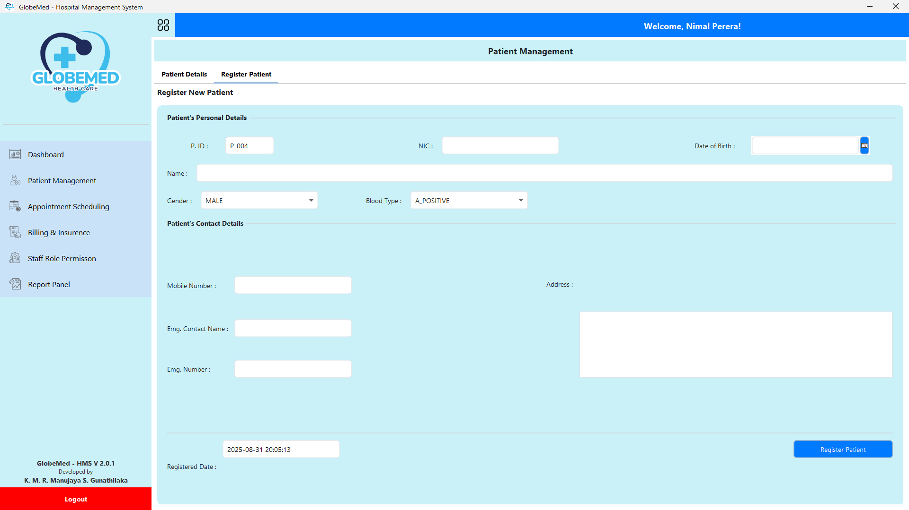
      <br><sub><b>Patient Registration</b></sub>
    </td>
    <td align="center">
      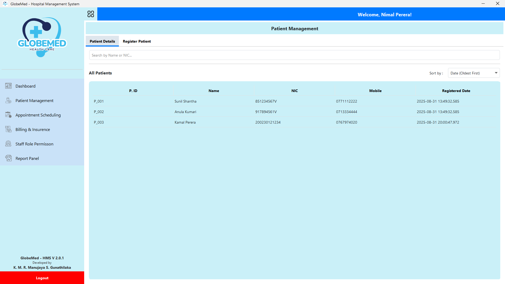
      <br><sub><b>Patient Dashboard</b></sub>
    </td>
     <td align="center">
      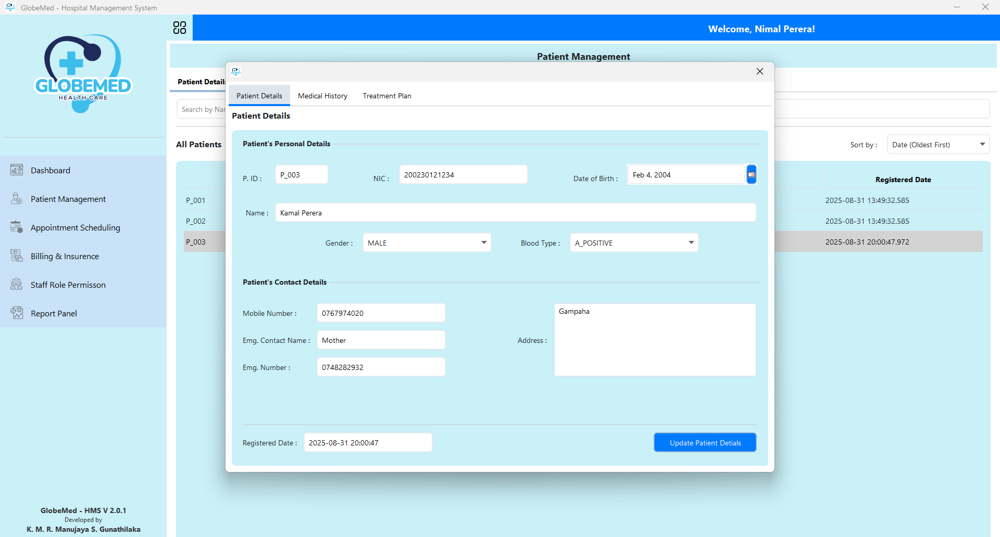
      <br><sub><b>Detailed Patient Records</b></sub>
    </td>
  </tr>
</table>
</details>

<details>
<summary><strong>🗓️ Appointment Scheduling</strong></summary>
<br>
An efficient, decoupled module for booking and managing patient appointments, powered by the <strong>Mediator Pattern</strong>.

<table>
  <tr>
    <td align="center">
      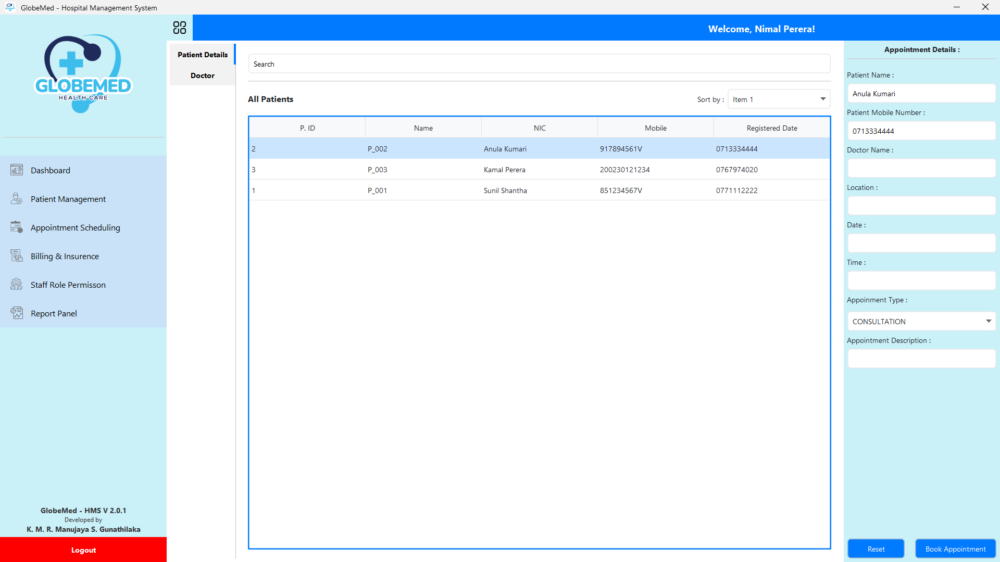
      <br><sub><b>Select Patient and Doctor</b></sub>
    </td>
    <td align="center">
      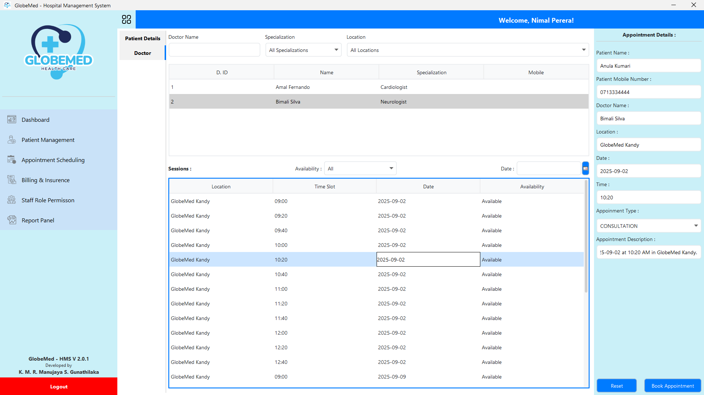
      <br><sub><b>Choose Date and Time</b></sub>
    </td>
  </tr>
</table>
</details>

<details>
<summary><strong>🧾 Billing & Claims Processing</strong></summary>
<br>
A flexible, multi-step workflow for handling billing and insurance claims, demonstrating the <strong>Chain of Responsibility Pattern</strong>.

<table>
  <tr>
    <td align="center">
      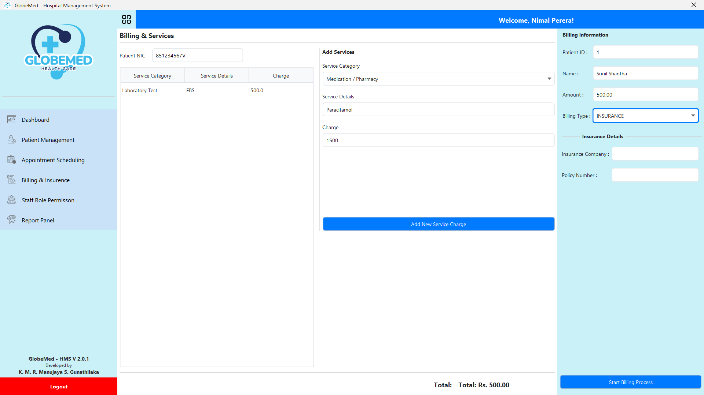
      <br><sub><b>Enter Service Details</b></sub>
    </td>
    <td align="center">
      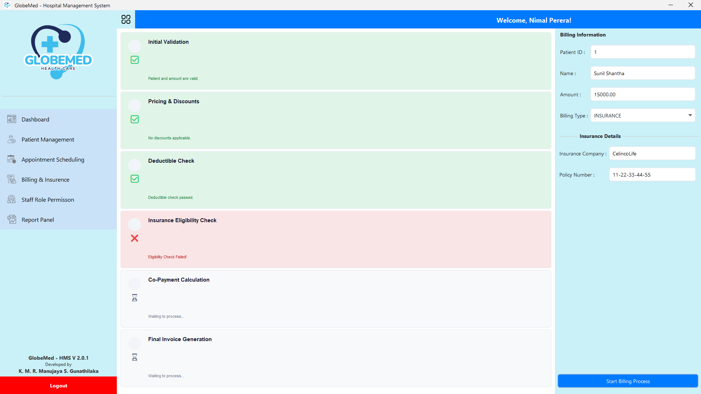
      <br><sub><b>View Claim Status</b></sub>
    </td>
  </tr>
</table>
</details>

<details>
<summary><strong>🛡️ Secure Auditing & Admin Dashboard</strong></summary>
<br>
A secure, admin-only dashboard providing system statistics and access to audit logs. Data is protected using a compound <strong>Proxy & Decorator Pattern</strong>, which encrypts sensitive log details for non-admin users.
<p align="center">
  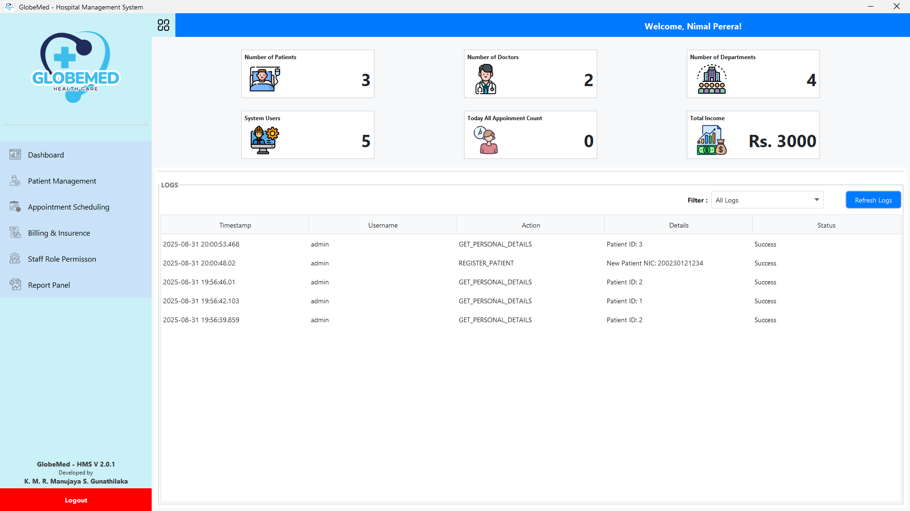
</p>
</details>

<details>
<summary><strong>⚙️ Permissions & Role Management</strong></summary>
<br>
Granular control over user permissions in a hierarchical structure, managed by the <strong>Composite Pattern</strong>.
<p align="center">
  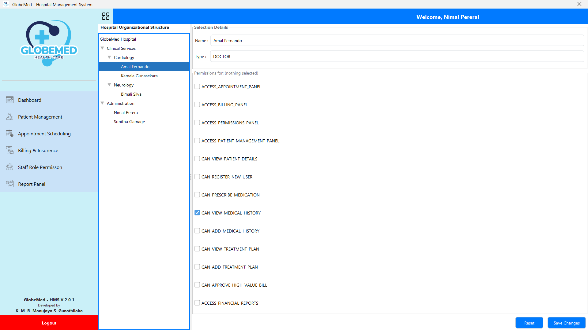
</p>
</details>

<details>
<summary><strong>📊 Comprehensive Report Generation</strong></summary>
<br>
The ability to generate diverse reports from system data without modifying core data models, showcasing the <strong>Visitor Pattern</strong>.

<table>
  <tr>
    <td align="center">
      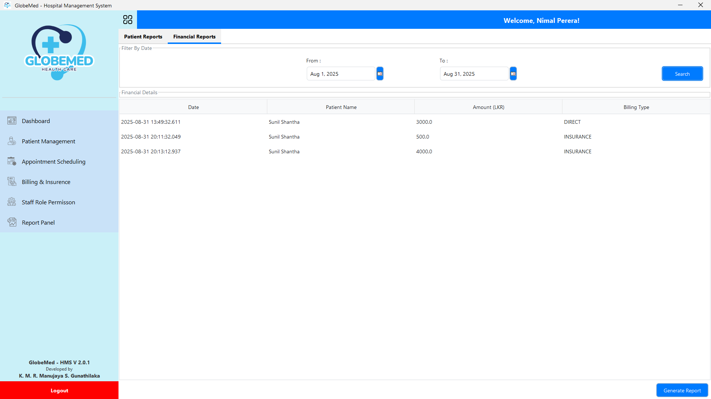
      <br><sub><b>Financial Report Panel</b></sub>
    </td>
    <td align="center">
      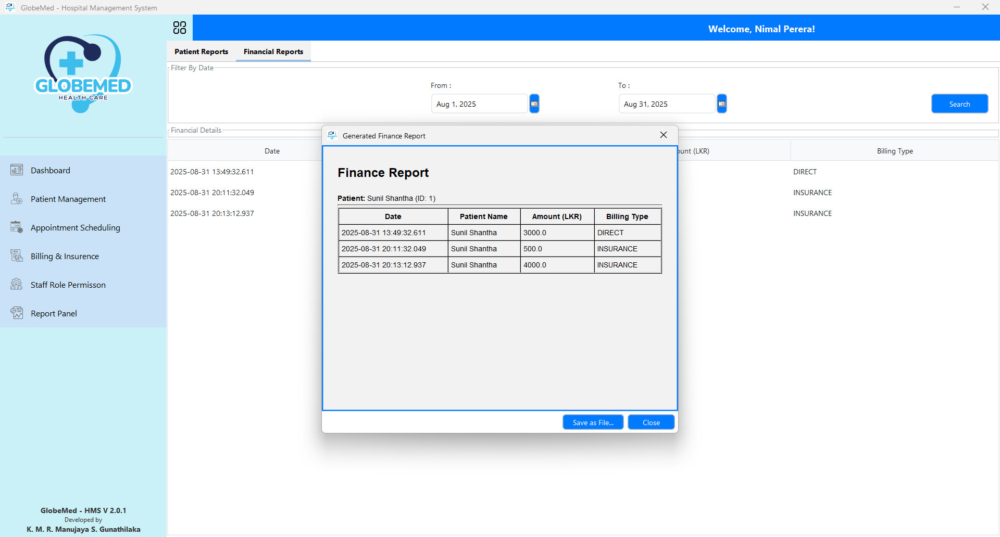
      <br><sub><b>Financial Report Preview</b></sub>
    </td>
  </tr>
</table>
</details>

---

## 3. System Architecture

### 3.1 Layered Architecture

The GlobeMed system is built upon a **Layered Architecture** to ensure a clean separation of concerns and promote modularity. This architectural style divides the application into distinct layers, where each layer has a specific responsibility.

* **User Interface (UI) Layer:** The top-most layer responsible for all user interactions.
* **Service Layer:** Contains the core business logic of the application.
* **Repository (DAO) Layer:** Responsible for all data access and persistence operations.
* **Model Layer:** Consists of the domain objects that represent the application's data (`Patient`, `Doctor`, etc.).

### 3.2 Persistence Layer: JPA & Hibernate

The persistence layer of the GlobeMed system is managed using the **Java Persistence API (JPA)** with **Hibernate** as the Object-Relational Mapping (ORM) provider.

> The decision to adhere to the JPA specification was driven by the need for a universal, standardized approach to managing the persistence layer. By programming to a standard API rather than a specific implementation, the system remains decoupled from the underlying ORM provider, which increases long-term flexibility.

This approach facilitates easier integration with enterprise-level services and provides robust support for database connectivity. Leveraging JPA gives us full control over transaction management, enabling the implementation of efficient and reliable strategies for handling data operations. Hibernate was selected as the JPA provider due to its mature, feature-rich, and high-performance capabilities.

---

## 4. Design Patterns and Their Role

The architecture is heavily influenced by the strategic application of six core object-oriented design patterns. Each was chosen to solve a specific design problem, contributing to a system that is flexible, maintainable, and scalable.

| Design Pattern | Role in the Project |
| :--- | :--- |
| **Decorator** | Dynamically adds responsibilities like logging and validation. |
| **Mediator** | Decouples backend components in the appointment scheduling module. |
| **Chain of Responsibility** | Creates a flexible, multi-step workflow for billing and claims. |
| **Composite** | Manages a hierarchical structure of permissions uniformly. |
| **Visitor** | Separates reporting logic from core data objects. |
| **Proxy & Decorator** | Provides layered security with access control and auditing. |

---

## 5. Technology Stack

* **Language:** Java
* **User Interface:** Java Swing
* **Persistence:** Java Persistence API (JPA) with Hibernate
* **Database:** Relational Database (e.g., MySQL, PostgreSQL)

---

## 6. System Diagrams

### UML Class Diagram
The complete class diagram for the system is provided below, illustrating the relationships between all major classes, interfaces, and entities.

<p align="center">
  
</p>

---

## 7. Getting Started

To get a local copy up and running, follow these steps:

### Prerequisites

* **JDK (Java Development Kit) 11** or higher
* **Apache Maven**
* **MySQL Server** (or any compatible SQL database)

### Installation & Configuration

1. Clone the repository:
   ```sh
   git clone https://github.com/manujayagunathilaka/globemed-hms.git
   ```

2. Configure environment settings:
   - Copy `.env.example` to a new file named `.env` in the project root:
     ```sh
     cp .env.example .env
     ```
   - Open the `.env` file and configure your database parameters (`DB_URL`, `DB_USER`, `DB_PASSWORD`).
   - **Note:** Never commit the `.env` file to version control. It is already added to `.gitignore`.

3. Database Setup:
   - Make sure your local MySQL server is running.
   - Import the schema script to create the database and tables:
     ```sh
     mysql -u your_username -p < database/schema.sql
     ```
   - (Optional) Import the seed script to load test accounts and sample schedules:
     ```sh
     mysql -u your_username -p < database/seed.sql
     ```
   - *Note:* If the database is completely empty on startup, the application's built-in `DatabaseSeeder` will automatically seed the initial master data as well.

4. Build the project using Maven:
   ```sh
   mvn clean compile
   ```

5. Run the application:
   ```sh
   mvn exec:java
   ```

---

## 8. Project Structure

```txt
globemed-hms/
├── .github/                  # GitHub configurations & action workflows
│   ├── workflows/            # Maven compilation CI
│   ├── ISSUE_TEMPLATE/       # Bug & Feature issue templates
│   └── PULL_REQUEST_TEMPLATE.md
├── database/                 # SQL database reference files
│   ├── schema.sql            # Database schema definition
│   └── seed.sql              # Database seed inserts
├── docs/                     # Media assets and diagrams
├── src/
│   ├── main/
│   │   ├── java/             # Source Java code package
│   │   └── resources/        # Persistence settings and look & feel styles
├── .env.example              # Environment variables template
├── .gitignore
├── pom.xml                   # Maven build configuration
└── README.md
```

---

## 9. Author

* **Manujaya Gunathilaka**
* GitHub: [manujayagunathilaka](https://github.com/manujayagunathilaka)

---

## 10. License

This project is licensed under the [Apache License 2.0](./LICENSE). See the [LICENSE](./LICENSE) file for details.